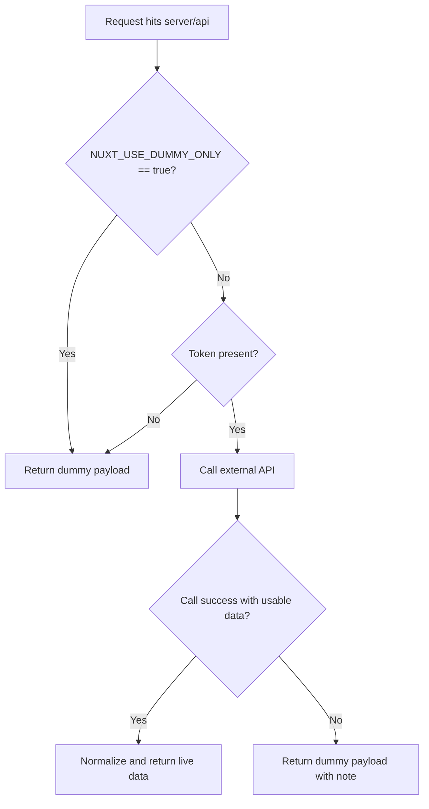
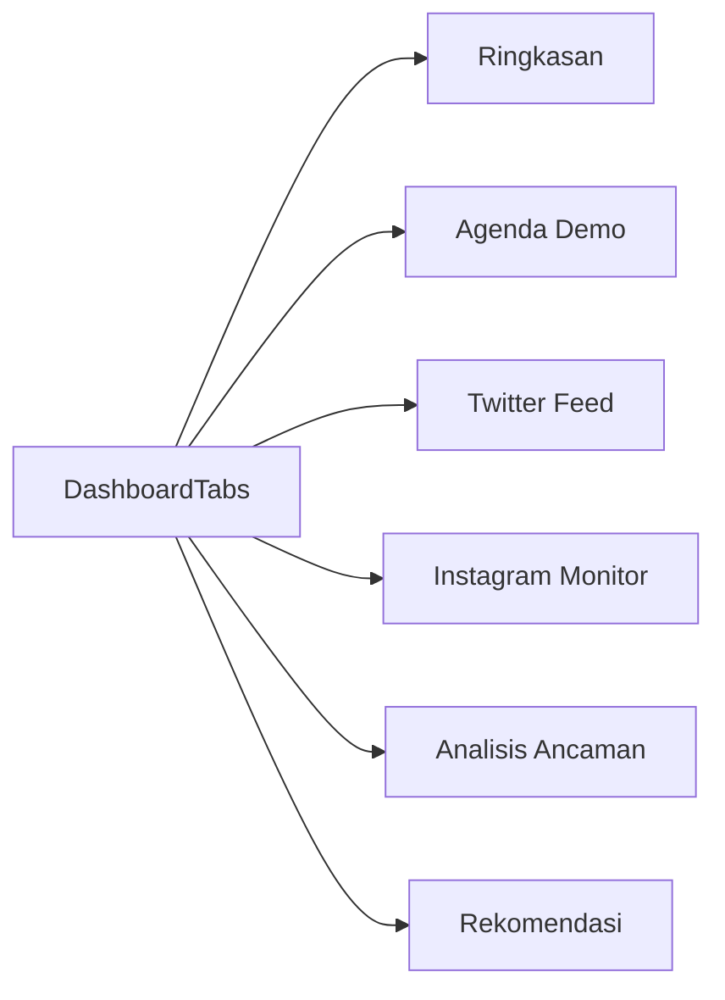
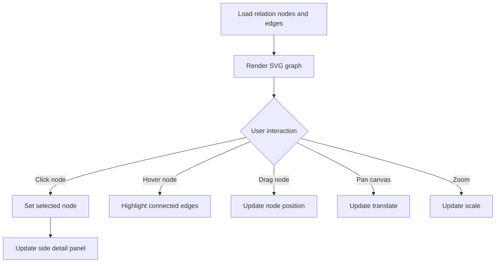
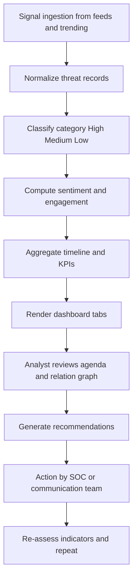

# Dashboard Flow Documentation

This document explains both technical architecture flow and operational threat-monitoring flow used by Request-Pussiber.

## 1) Architecture Flow

```mermaid
flowchart LR
  UI[Nuxt UI Tabs and Components]
  CMP[useThreatData composable]
  API1[/api/twitter route]
  API2[/api/instagram route]
  U1[utils/twitter.ts]
  U2[utils/instagram.ts]
  LIVE[X and Instagram APIs]
  DUMMY[Deterministic Dummy Data]

  UI --> CMP
  CMP --> API1
  CMP --> API2
  API1 --> U1
  API2 --> U2
  U1 --> LIVE
  U2 --> LIVE
  U1 --> DUMMY
  U2 --> DUMMY
  DUMMY --> API1
  DUMMY --> API2
  API1 --> CMP
  API2 --> CMP
  CMP --> UI
```

## 2) Runtime Decision Flow (Dummy vs Live)



## 3) UI Navigation Flow



## 4) Threat Analysis Graph Interaction Flow



## 5) Operational Monitoring Flow



## 6) Data Objects Used in Flow

- `ThreatRecord`: canonical mention/post record.
- `AgendaDemoItem`: event planning and escalation model.
- `RelationNode` and `RelationEdge`: actor relationship graph.
- `RecommendationItem`: action recommendations with confidence.

## 7) Validation Checklist

- Tabs render and switch correctly.
- Dummy mode provides complete payloads for all panels.
- Graph interactions work: click, drag, pan, zoom, highlight.
- Recommendation and agenda panels link back to evidence data.
